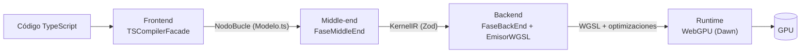

#  Middle-end y backend: qué hacen, cómo lo hacen y por qué

Guía explicativa de todo el trabajo hecho sobre el transpilador TS → WGSL, con foco en el **middle-end** y el **backend**. Está escrita para que alguien que no vio el código pueda entender las decisiones, no solo el resultado.

> Los números de rendimiento son de **una sola máquina** (Ryzen AI 9 365 con Radeon 880M, GPU integrada). Sirven para comparar caminos y optimizaciones entre sí, no como cifras generales.

---

## 1. El recorrido completo




| Fase           | Pregunta que responde                                                                               | Entrega               | Archivo principal                  |
| -------------- | --------------------------------------------------------------------------------------------------- | --------------------- | ---------------------------------- |
| **Frontend**   | ¿Qué bucles `for` contados hay y cómo se ven por dentro?                                            | `NodoBucle`           | `src/frontend/TSCompilerFacade.ts` |
| **Middle-end** | ¿Se puede ejecutar cada bucle en paralelo sin que dos hilos se pisen? ¿Cómo se expresa como kernel? | `KernelIR`            | `src/middleend/FaseMiddleEnd.ts`   |
| **Backend**    | ¿Cómo se escribe ese kernel en WGSL, y cómo se lo optimiza?                                         | `Shader` (texto WGSL) | `src/backend/EmisorWGSL.ts`        |
| **Runtime**    | ¿Cómo se ejecuta en la GPU y cómo se mide?                                                          | resultados y tiempos  | `src/runtime/`                     |


El pipeline se arma en `src/core/TranspiladorTSaWGSL.ts` con un `PipelineBuilder`: frontend → middle-end → backend. Las fases se pasan un `ContextoPipeline` que acumula `buclesCandidatos`, `buclesAptos`, `kernels`, `shaders` y `diagnosticos`. **Cada decisión de rechazo queda como diagnóstico con la fase que la tomó**, así el usuario sabe por qué un bucle no se volvió kernel.

**Quién hizo qué.** El frontend (`TSCompilerFacade`, `FaseFrontEnd`, `Modelo.ts`) y el contrato inicial del frontend son del compañero que lo desarrolla; aquí solo se le agregó el reconocimiento de `x!`, de `let x = …` y de asignaciones compuestas (`+=`, `-=`, `*=`, `/=`). El contrato IR, el emisor WGSL, la tabla de símbolos y `FaseBackEnd` existían como parte del backend; se corrigieron y ampliaron. El **middle-end se escribió en esta etapa**.

---

## 2. Middle-end

### 2.1 Qué hace

Recibe cada `NodoBucle` candidato y lo convierte en un `KernelIR` (una descripción de lo que hace **cada hilo** de la GPU) o lo descarta con un motivo. Lo hace una clase `Reductor` por bucle, en cuatro etapas:

```
separarGrid → analizar → verificarDependencias → lowering a IR
```

### 2.2 Etapa 1 — `separarGrid`: ¿qué bucles se reparten entre hilos?

Cada iteración del bucle externo pasa a ser **un hilo**.

- El bucle externo debe empezar en el literal `0` y avanzar de a `1` (si no, se rechaza).
- Si su cuerpo es **exactamente otro bucle** y la cota de ese bucle no depende de los iteradores anteriores, también pasa a ser una dimensión del grid (`gid.x`, `gid.y`, `gid.z`): hasta **3 dimensiones**.
- `i <= n` se trata como `i < n + 1`.
- Un bucle que no cumple queda como `for` interno del hilo.

### 2.3 Etapa 2 — `analizar`: ¿qué sentencias se aceptan?


| Se acepta                                                                                                                             | Ejemplo                                            |
| ------------------------------------------------------------------------------------------------------------------------------------- | -------------------------------------------------- |
| Escribir un elemento de arreglo con **un solo índice lineal**                                                                         | `a[i * N + j] = …`                                 |
| Declarar una variable local                                                                                                           | `let suma = 0;`                                    |
| Asignar o acumular sobre una local **declarada dentro del kernel**                                                                    | `suma += x[k]!` (se normaliza a `suma = suma + …`) |
| Bucle interno con paso 1 (inicio y cota cualquiera, pueden ser triangulares)                                                          | `for (let k = 0; k < N; k++)`                      |
| Expresiones con `+ - * /`, números, variables, paréntesis, `!`, `a[idx]` y `Math.sqrt sin cos tan abs exp log floor ceil pow min max` |                                                    |


| Se rechaza (queda como diagnóstico)                                          | Por qué                                        |
| ---------------------------------------------------------------------------- | ---------------------------------------------- |
| `if`, `while`, `return`, ternario `?:`, comparaciones, `%`, `**`             | todavía no hay divergencia de control en el IR |
| Escribir una variable declarada **fuera** del bucle (`total += a[i]`)        | es una reducción entre hilos: carrera de datos |
| Indexado `a[i][j]`                                                           | el IR usa índices lineales                     |
| Llamar funciones propias, `Math.PI`, negar una variable (`-x`; usar `0 - x`) | no soportado                                   |
| Una local con el nombre de un iterador                                       | lo ocultaría                                   |


Mientras recorre el cuerpo, esta etapa **junta información** para las siguientes: qué buffers se leen y cuáles se escriben (de ahí sale `read` / `write` / `readwrite`), qué variables se usan como índice o límite (serán enteras), y qué variables locales existen, con su definición y si se reasignan.

### 2.4 Etapa 3 — `verificarDependencias`: ¿se pisarían dos hilos?

Esta es la etapa de seguridad. Un resultado incorrecto en la GPU es silencioso, así que **ante la duda, se rechaza**. Reglas:

1. **Cada arreglo escrito se escribe con un único índice** (la misma expresión en todas las sentencias que lo escriben).
2. **Ese índice debe ser inyectivo sobre el grid** (sección 2.5): dos hilos distintos nunca escriben la misma posición.
3. **Si un arreglo se lee y también se escribe, se lee solo con ese mismo índice.** Así cada hilo lee únicamente lo que él mismo escribe (`a[i] = a[i] * 2` es válido; `a[i] = a[i + 1]` no).

### 2.5 La regla de inyectividad (`src/middleend/Inyectividad.ts`)

**Problema.** Al principio la única comprobación era "el índice de escritura menciona cada iterador del grid". Es necesaria pero **no suficiente**. Se confirmó con tres casos que se aceptaban como kernel aunque dos hilos escribían la misma posición:


| Código                   | Colisión                                |
| ------------------------ | --------------------------------------- |
| `a[i + j] = …` (grid 2D) | los hilos (1,2) y (2,1) escriben `a[3]` |
| `a[i / 2] = …`           | los hilos 2 y 3 escriben `a[1]`         |
| `a[i * 0] = …`           | todos escriben `a[0]`                   |


**Método (base mixta).** Se descompone el índice en `c₁·i₁ + c₂·i₂ + … + resto` (el resto no depende de los iteradores) y se busca un orden de los iteradores tal que:

- el coeficiente del primero es una **constante positiva**, y
- cada coeficiente siguiente es **al menos** el anterior multiplicado por el tamaño del anterior: `c(k+1) − c(k)·S(k)` es una constante ≥ 0.

Así los rangos de cada término no se solapan: es lo que hace `i·N + j` con `j < N` (fila mayor). Los coeficientes y los tamaños son **polinomios en los parámetros** (`N`, `N − 2`, `N·N`), de modo que se prueba sin saber cuánto vale `N`. Un coeficiente negativo se acepta si todos sus términos tienen el mismo signo (`a[n - 1 - i]`).


| Se acepta                                                      | Se rechaza                                            |
| -------------------------------------------------------------- | ----------------------------------------------------- |
| `a[i]`, `a[2*i + 1]`                                           | `a[i + j]`                                            |
| `a[i*N + j]`, `a[j*N + i]`                                     | `a[i / 2]`, `a[i * 0]`                                |
| `a[(i+1)*N + (j+1)]` con `i, j < N-2` (interior de un stencil) | `a[i * N]` (`N` podría valer 0)                       |
| `a[(i*N + j)*N + k]`                                           | `a[i*2 + j]` con `j < 3` (colisiona)                  |
| `a[n - 1 - i]`                                                 | `a[i*N + j]` con `j < M` (`M` no relacionado con `N`) |
| `a[i*3 + j]` con `j < 3`                                       | `a[i * j]`, `a[b[i]]` (depende de los datos)          |


**Variables locales.** Una local que **nunca se reasigna** se sustituye por su definición: `const c = (i+1)*N + (j+1); a[c] = …` se analiza como `a[(i+1)*N + (j+1)]`. Si se reasigna, o viene de los datos, no se sigue y la escritura se rechaza.

**Un bucle interno** solo entra en la prueba si su iterador aparece en el índice: si no aparece, el mismo hilo reescribe la misma posición en orden, y eso no es una carrera.

**Es una condición suficiente, no necesaria.** Puede rechazar escrituras que en realidad son seguras; lo que nunca debe hacer es aceptar una que no lo sea.

**Defensa en profundidad.** El middle-end es la última puerta antes de emitir un kernel. Si el frontend llega a hacer su propio análisis (dominios de iteración, funciones de acceso, condiciones de Bernstein), esta regla queda como segunda barrera, sin estorbar. *Hoy ese análisis no existe en el frontend* (se verificó en `origin/main`).

### 2.6 Etapa 4 — lowering: de `NodoBucle` a `KernelIR`

- **Tipos.** Todo `number` de TypeScript pasa a `f32`. Los escalares usados como **índice o límite** de bucle pasan a `i32`. Si en una expresión se mezclan `i32` y `f32`, ambos operandos se promueven a `f32` con un `cast`. Los literales toman el tipo del contexto.
- **Buffers.** Siempre `f32`; el acceso (`read`, `write`, `readwrite`) sale del uso real.
- **Parámetros.** Las variables libres (ni iterador ni local) son parámetros escalares del kernel.
- **Locales.** `let x = e` pasa a `var` y `x = e` a `set`, con tipo `f32` salvo que se use como índice.
- **Salida.** `KernelIR { irVersion: 1, name: "kernel_<id>", params, buffers, grid, body }`.

---

## 3. Backend

### 3.1 El contrato IR (`src/ir/ir-contract.ts`)

Describe **qué hace un hilo**:

- `Expr`: `lit`, `ref`, `read`, `bin`, `unary`, `cast`, `call`, `select`.
- `Stmt`: `var`, `set`, `store`, `for`.
- Tipos de dato `i32 | u32 | f32`, acceso `read | write | readwrite`, grid de 1 a 3 dimensiones, `irVersion: 1`.
- Los tipos (`Expr`, `Stmt`) están **escritos a mano** y los schemas de Zod se tipan contra ellos (`z.ZodType<Expr>`): así el `switch` del emisor tiene verificación de exhaustividad y los dos no pueden desincronizarse sin que el compilador avise.

`FaseBackEnd` valida cada kernel con `KernelIRSchema.parse` antes de emitir. Hoy es redundante (el middle-end ya produce IR bien formado), pero protege al backend si el IR llega de otra fuente, y convierte un IR roto en un error claro en lugar de un shader con `undefined` adentro.

### 3.2 `Bindings.ts`: la fuente única del reparto de recursos

Dos decisiones que **el emisor y el runtime deben tomar igual**; por eso viven en un solo archivo:

- **`calcularBindings`**: `params` va en el `@binding(0)` (si existe) y los buffers siguen en orden. El emisor escribe esos números en el shader y el runtime crea los buffers con los mismos.
- **`tamanoWorkgroup`**: 1D → 64×1×1, 2D → 8×8×1, 3D → 4×4×4.
- **`asignarEjes`**: decide **qué iterador del grid corre en `gid.x`**. Los hilos de un grupo avanzan primero por `x`; si `x` recorre el índice **contiguo** en memoria, hilos vecinos acceden a posiciones vecinas (acceso unido) y la GPU aprovecha el ancho de banda. En `C[i*N + j]`, `j` es contiguo, así que `j` debe ir a `x`.

  La regla analiza cada índice de buffer y clasifica el paso de cada iterador como **unitario** (aparece sumado directamente), **grande** (multiplicado por otra cosa) o **ausente**. `x` va al iterador con más accesos unitarios; si hay empate o ninguno, se conserva el orden original. **Sigue las variables locales constantes** (`const c = (i+1)*N + (j+1); a[c]`), porque sin eso el stencil quedaba con acceso no contiguo.

> **Medido:** en una multiplicación de matrices de 1024², cambiar este mapeo bajó el tiempo por lanzamiento de ~3,2 ms a ~0,7 ms medido con el reloj de pared (×4,5), con el **mismo resultado**.

### 3.3 `TablaSimbolos`

- Registra parámetros, buffers, iteradores y variables locales; falla si se usa un símbolo no declarado o repetido.
- **Rechaza identificadores reservados de WGSL** (`fn`, `var`, `array`, `vec3`…) y los nombres internos del emisor (`params`, `gid`).
- **Ámbitos:** cada `for` abre un ámbito y al cerrarlo olvida sus variables, así dos bucles hermanos pueden declarar la misma variable local.

### 3.4 `EmisorWGSL`

Para cada kernel produce el texto WGSL en este orden:

1. **Símbolos** (parámetros, buffers, iteradores).
2. **Encabezado:** `struct Params` como `var<uniform>` y un `var<storage, read | read_write>` por buffer, con los `@binding` de `calcularBindings`.
3. **Cuerpo:** `@compute @workgroup_size(…)`, las variables de iteradores (`let j = i32(gid.x)`), la **guarda** `if (i >= size) { return; }` para los hilos sobrantes, y las sentencias. Una escritura sobre un buffer de solo lectura se rechaza.

Ejemplo real (el caso `vectores`):

```wgsl
struct Params { n: i32, };
@group(0) @binding(0) var<uniform> params: Params;
@group(0) @binding(1) var<storage, read_write> salida: array<f32>;
@group(0) @binding(2) var<storage, read> vectorA: array<f32>;
@group(0) @binding(3) var<storage, read> vectorB: array<f32>;
@compute @workgroup_size(64, 1, 1)
fn kernel_bucle_0(@builtin(global_invocation_id) gid: vec3<u32>) {
  let i = i32(gid.x);
  if (i >= params.n) { return; }
  salida[i] = ((vectorA[i] * 3.14) - vectorB[i]);
}
```

Detalles: los literales `f32` enteros se escriben con `.0`, las expresiones se parentizan siempre, y `select` invierte el orden de argumentos al de WGSL.

El emisor guarda en `optimizaciones` qué aplicó, y `FaseBackEnd` lo copia al `Shader` para que el benchmark y la página lo informen.

### 3.5 Optimización: baldosas en memoria compartida (`Baldosas.ts`)

**Idea.** En una multiplicación de matrices cada hilo lee de memoria global una fila de `A` y una columna de `B` enteras, y miles de hilos leen lo mismo. Con baldosas, el grupo de **16×16 hilos** carga un bloque de `A` y otro de `B` en **memoria compartida** (rápida, dentro del chip), todos lo reutilizan 16 veces y recién entonces se pasa al bloque siguiente. Se lee de la memoria global ~16 veces menos.

**Cuándo se aplica.** Solo si el IR es **exactamente** este patrón (`detectarBaldosas`); ante cualquier diferencia, se emite el kernel ingenuo, que siempre es correcto:

- Grid de 2 dimensiones y cuerpo de exactamente 3 sentencias: `var acc` en `f32`, un `for k` y un `store`.
- El `for` empieza en 0 y su cota **solo depende de parámetros** (es la misma para todo el grupo).
- `acc = acc + A[fila·S + k] · B[k·S' + col]`, con `A` y `B` en `f32`, solo lectura y distintos del buffer de salida.
- `gid.x` recorre las columnas y ningún símbolo choca con los nombres internos (`tileA_`, `lx_`, …).

**Reglas de WGSL que condicionan la forma.**

- `workgroupBarrier()` exige que **todos** los hilos del grupo lleguen a ella: por eso el kernel con baldosas **no tiene `return` temprano**. Protege las lecturas y la escritura final con guardas, y carga `0.0` fuera de rango (no altera la suma).
- El lanzamiento necesita el tamaño de workgroup real (16×16, no 8×8): el runtime lo **lee del propio shader** (`leerWorkgroup`), así no puede desincronizarse del emisor.

> **Medido** (kernel que genera el transpilador, GPU real, mismo resultado exacto): 1024² pasó de 83,5 ms a 27,8 ms (**×3,0**, de 26 a 77 GFLOPS).

---

## 4. Los casos de entrada y qué ejercitan


| Caso          | Qué calcula                                | Qué aporta                                    |
| ------------- | ------------------------------------------ | --------------------------------------------- |
| `vectores`    | `salida[i] = A[i] * 3.14 - B[i]`           | un bucle simple, 1D                           |
| `matrices`    | `C[i,j] = A[i,j] + B[i,j]`                 | grid 2D, índice lineal                        |
| `monte-carlo` | `sqrt(p * 2.5) + sin(p)`                   | funciones matemáticas                         |
| `matmul`      | multiplicación de matrices real            | acumulador local, bucle interno, **baldosas** |
| `nbody`       | gravedad entre todos los pares, O(n²)      | mucho cálculo por dato: el terreno de la GPU  |
| `calor`       | un paso de la ecuación del calor (stencil) | locales en el índice, doble búfer             |


---

## 5. Lo que rodea al backend (resumen)

- **Runtime (`src/runtime/`):** crea el dispositivo (usa `navigator.gpu` o Dawn en Node), sube buffers, compila el shader **una sola vez** y lo lanza muchas veces, mide con `timestamp-query`, lee los resultados, y permite lanzar varios pasos **intercambiando dos buffers** (`intercambio` + `bufferFinal`) para simular de verdad.
- **Benchmark (`benchmark.ts`):** calentamiento, repeticiones, mediana, **modo amortizado** (subir una vez, lanzar `k` veces, leer una vez) y una **línea base de CPU de 1 hilo y de N hilos**. La CPU multihilo debe dar un resultado **idéntico** al de la función original; si no, el benchmark se detiene. La GPU compite contra la **mejor** de las dos CPU.
- **Servidor (`src/server/`) y página (`web/index.html`):** servidor local solo en `127.0.0.1`, con progreso en vivo, botón Cancelar, modo rápido, gráficos y glosario.

---

## 6. Lo que se encontró y se corrigió en el camino


| Hallazgo                                                               | Qué se hizo                                                                                                                              |
| ---------------------------------------------------------------------- | ---------------------------------------------------------------------------------------------------------------------------------------- |
| El dispositivo WebGPU se caía al azar (`futex…` / segmentation fault)  | `gpu` y `adapter` eran variables locales y el recolector de basura liberaba el dispositivo en uso. Ahora se retienen hasta `destruir()`. |
| Matrices 8× más lentas por elemento que vectores                       | Mapeo de ejes no contiguo: nueva regla `asignarEjes`.                                                                                    |
| Escrituras con colisión aceptadas                                      | Regla de inyectividad.                                                                                                                   |
| El cronómetro de la GPU subestimaba hasta 4–8×                         | Se muestran cronómetro y pared; el resultado usa el **mayor** de los dos. En Windows nativo coinciden: era un defecto de Dozen.          |
| Los tiempos del cronómetro salían de a 65 µs                           | Dawn los cuantiza; se desactivó para uso local (`disable-dawn-features=timestamp_quantization`).                                         |
| La CPU multihilo de `calor` no coincidía con la original               | Error de reparto de filas, atrapado por la verificación automática.                                                                      |
| Un experimento pasó el límite de \~2 s de la GPU en Windows y se colgó | Tope de seguridad de \~0,8 s por envío, predicho con tiempo de pared.                                                                    |
| El servidor se congelaba con tamaños grandes                           | La CPU de 1 hilo se mide en el mismo hilo del servidor. *Pendiente:* moverla a un worker.                                                |


---

## 7. Qué se midió sobre el camino de ejecución

Misma máquina, misma GPU, mismo código (medianas en ms). **WSL** usa Vulkan sobre Dozen; **Windows** usa Direct3D 12 directo.


| Caso        | GPU total WSL → Windows | Espera WSL → Windows | Lectura WSL → Windows |
| ----------- | ----------------------- | -------------------- | --------------------- |
| calor 128   | 49,7 → 0,87             | 24,8 → 0,17          | 23,3 → 0,25           |
| calor 2048  | 56,1 → 16,8             | 12,7 → 1,35          | 16,6 → 4,55           |
| nbody 4096  | 70,7 → 1,13             | 35,1 → 0,42          | 40,8 → 0,31           |
| nbody 16384 | 56,5 → 2,86             | 45,4 → 1,90          | 14,9 → 0,53           |


- Cayeron sobre todo la **espera** (sincronización) y la **lectura**; la subida solo mejora con datos grandes.
- El **cómputo también** se aceleró 6–14×: no era solo mover datos.
- En n-cuerpos 16384, la GPU pasó de ×1,9 a **×36** contra la mejor CPU.
- El **calor** sigue perdiendo de punta a punta (CPU ×8,3 en 2048²): mover 16 MB de ida y vuelta pesa más que calcular, aunque su cómputo puro sí gana.

**Conclusión práctica:** el rendimiento se mide en Windows nativo. WSL sirve para los tests de corrección.

---

## 8. Límites conocidos y pendientes

- La optimización de baldosas cubre **solo la multiplicación de matrices**, con baldosas fijas de 16×16.
- No hay todavía condicionales (`if`, ternario), comparaciones, reducciones ni números aleatorios.
- Un kernel 1D no pasa de 65.535 × 64 ≈ 4,19 millones de elementos (límite de workgroups por eje).
- La regla de inyectividad es **conservadora**: puede rechazar escrituras seguras.
- Los resultados dependen de una GPU integrada; en una con memoria propia el calor podría cambiar. No se probó.
- Hay ruido de la máquina entre sesiones (hasta ~4×): conviene repetir antes de citar un número.
- Pendiente: mover la medición de la CPU de 1 hilo a un worker.

---

## 9. Cómo probarlo

```bash
pnpm test                        # compila y corre los 98 tests (sobre llvmpipe si no hay GPU real)
pnpm gpu-info                    # qué GPU ve Dawn y si es de software
pnpm servidor                    # benchmark en http://localhost:3000
source scripts/wsl-gpu.sh        # solo en WSL: usa la GPU real vía Dozen
```

Más detalle en `docs/BENCHMARK.md` (método de medición), `docs/GPU-EN-WSL.md` (GPU en WSL) y `docs/CONTRATO-FRONTEND.md` (qué espera el middle-end del frontend).

## 10. Mapa de archivos


| Carpeta               | Contenido                                                                          |
| --------------------- | ---------------------------------------------------------------------------------- |
| `src/core/`           | pipeline, contexto, interfaces y el modelo de datos del frontend                   |
| `src/frontend/`       | conversión de TypeScript a `NodoBucle` (compañero)                                 |
| `src/middleend/`      | `FaseMiddleEnd.ts` (decide y baja a IR), `Inyectividad.ts` (prueba sin colisiones) |
| `src/ir/`             | contrato `KernelIR` con Zod                                                        |
| `src/backend/`        | `EmisorWGSL`, `Bindings`, `Baldosas`, `TablaSimbolos`, `FaseBackend`               |
| `src/runtime/`        | dispositivo, buffers, dispatch, lectura, benchmark, CPU multihilo                  |
| `src/server/`, `web/` | servidor local y página de resultados                                              |
| `src/pruebas/`        | los programas TypeScript de entrada                                                |
| `src/tests/`          | tests (98 en total)                                                                |


## 11. Glosario mínimo

- **Kernel:** el programa que ejecuta cada hilo de la GPU.
- **Grid:** el conjunto de hilos; cada dimensión corresponde a un bucle.
- **Workgroup:** grupo de hilos que comparten memoria rápida y se sincronizan.
- **Inyectiva:** una función que nunca da el mismo resultado para dos entradas distintas (aquí: dos hilos nunca escriben la misma posición).
- **Acceso unido (coalesced):** hilos vecinos acceden a posiciones vecinas de memoria.
- **Baldosa (tile):** bloque de datos que se copia a memoria compartida para reutilizarlo.
- **IR:** representación intermedia entre el análisis y la generación de código.